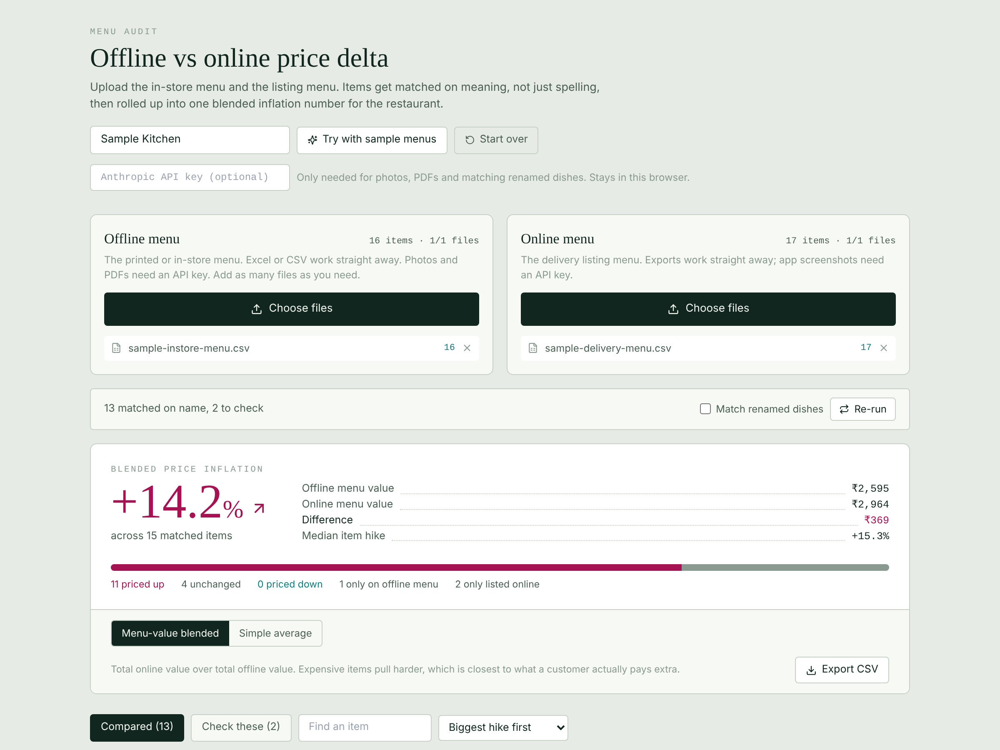
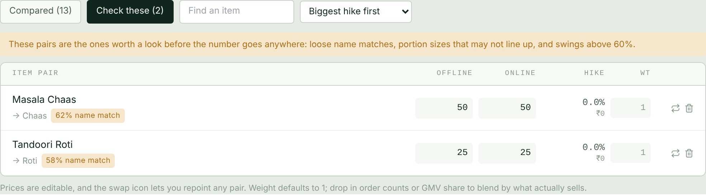

# Menu Price Audit

**Is this restaurant charging more on delivery than in the store, and by how much?**

Drop in the in-store menu and the delivery menu. The tool pairs up the same dish on both sides, even when the names don't match ("Paneer Butter Masala" vs "Paneer Makhani", "Kadhai" vs "Kadai"), and rolls the gaps into one blended price inflation number you can take into a conversation.

**[Live demo](https://AnshGupta6378.github.io/Menu-Price-Audit/)**: click **Try with sample menus** to see it work without uploading anything.



## Why I built it

Price parity between dine-in and delivery comes up a lot when you manage restaurant partners. Checking it by hand means lining up two menus that were typed by different people at different times, with different spellings, portions and section names. It's slow, and the answer depends on which items you happen to compare.

This does the matching in seconds and shows its working, so the number can be trusted (or challenged) item by item.

## How the matching works

It runs in three passes, from safest to loosest:

1. **Same name.** Names are cleaned up first: Hindi and English variants are mapped to one word (aloo → potato, murgh → chicken, makhani → butter), filler words like "special" or "signature" are dropped, and common misspellings are folded together.
2. **Similar name.** A mix of word overlap and edit distance scores every remaining pair. Portions are pulled out and compared separately, so "Biryani (Half)" is never paired with "Biryani (Full)".
3. **Same dish, different name** (optional, needs an API key). Whatever is still unpaired goes to Claude, with strict rules on what counts as the same dish (Paneer Tikka is not Paneer Tikka Masala; Dry is not Gravy).

Anything that looks shaky lands in a **Check these** tab instead of quietly moving the number: loose name matches, unclear portions, and price swings above 60%.



## What you get

- **Blended inflation:** total delivery value over total in-store value, so pricier dishes count for more. A simple average is one click away.
- **Order weighting:** put order counts or sales share in the weight column to blend by what actually sells.
- **Full control:** edit any price, repoint any pair, or drop an item from the comparison.
- **Leftovers:** dishes only on one menu, listed separately.
- **Talking points and CSV export.**

## Files it reads

| File | Works without a key? |
|---|---|
| CSV, Excel | Yes, read in your browser |
| PDF, photos, app screenshots | Needs an Anthropic API key |

The key is optional, stays in your browser, and is only sent to Anthropic. Sample files are in [`samples/`](samples/) if you want to try an upload.

## Run it locally

```bash
npm install
npm run dev
```

`npm run build` writes the site to `docs/`, which GitHub Pages serves from the main branch.

## Built with

React, Tailwind, PapaParse, SheetJS and the Claude API. Designed and built with Claude.

The sample menus are made up. No real restaurant's data is included.
